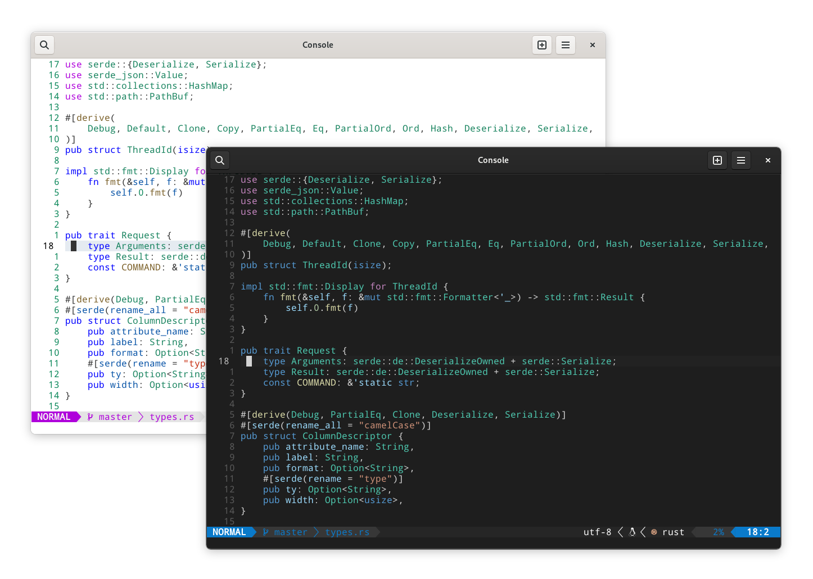

# vscode.nvim-modern

[](https://github.com/MartenBE/vscode.nvim-modern/actions)


vscode.nvim-modern is a fork of [vscode.nvim](https://github.com/Mofiqul/vscode.nvim) with a few key differences:

- **Faithful colors:** The palette tracks [VS Code's default Dark Modern and Light Modern themes](https://github.com/microsoft/vscode/tree/main/extensions/theme-defaults/themes) as closely as possible.
- **AI-assisted syncing:** Keeping colors in sync with VS Code by hand is tedious and error-prone, so updates are made with AI assistance against VS Code's main branch. This repo tracks about +/- 800 highlights per light/dark theme. Treating VS Code as the single source of truth through AI also avoids choice paralysis and endless tweaking over individual colors. Highlights can always be adjusted manually if you prefer (see below).
- **Snapshot testing:** Every change is captured in snapshots, making differences between commits easy to review and unintended changes easy to catch, for both humans and AI.
- **Neovim only:** Support is limited to Neovim, since that's what the snapshot tests can verify.
- **First-class light theme:** Light Modern gets the same care as Dark Modern rather than being an afterthought, thanks to a refactor that decouples variable names from their functionality.
- **Frequent updates:** Releases come more often than upstream because [@MartenBE](https://github.com/MartenBE) uses this theme daily.



:warning: Neovim can't reproduce everything VS Code draws due to rendering, LSP, treesitter, ... so differences may occur.

## Supported Plugins

- [BarBar](https://github.com/romgrk/barbar.nvim)
- [BufferLine](https://github.com/akinsho/nvim-bufferline.lua)
- [Dashboard](https://github.com/glepnir/dashboard-nvim)
- [Git Gutter](https://github.com/airblade/vim-gitgutter)
- [Git Signs](https://github.com/lewis6991/gitsigns.nvim)
- [Indent Blankline](https://github.com/lukas-reineke/indent-blankline.nvim)
- [LSP](https://github.com/neovim/nvim-lspconfig)
- [Lualine](https://github.com/nvim-lualine/lualine.nvim)
- [Neogit](https://github.com/NeogitOrg/neogit)
- [Neotest](https://github.com/nvim-neotest/neotest)
- [nvim-cmp](https://github.com/hrsh7th/nvim-cmp)
- [nvim-dap-ui](https://github.com/rcarriga/nvim-dap-ui)
- [nvim-scrollview](https://github.com/dstein64/nvim-scrollview)
- [NvimTree](https://github.com/kyazdani42/nvim-tree.lua)
- [rainbow-delimiters](https://gitlab.com/HiPhish/rainbow-delimiters.nvim)
- [Snacks.indent](https://github.com/folke/snacks.nvim/blob/main/docs/indent.md)
- [Telescope](https://github.com/nvim-telescope/telescope.nvim)
- [Treesitter](https://github.com/nvim-treesitter/nvim-treesitter)
- [Trouble](https://github.com/folke/trouble.nvim)
- [vim-illuminate](https://github.com/RRethy/vim-illuminate)
- [which-key](https://github.com/folke/which-key.nvim)

## Installation

It should be a drop in replacement for [vscode.nvim](https://github.com/Mofiqul/vscode.nvim).

```lua
vim.pack.add({ "https://github.com/MartenBE/vscode.nvim-modern" })

local vscode = require("vscode")

vscode.setup({
    -- E.g.
    italic_comments = true,
    underline_links = true,
    -- ...
})

vscode.load()
```

## Usage

```lua
-- For dark theme (neovim's default)
vim.o.background = "dark"
-- For light theme
vim.o.background = "light"

local vscode = require("vscode")
local c = require("vscode.colors").get_colors()

vscode.setup({
    -- Alternatively set style in setup
    -- style = "light"

    -- Enable transparent background
    transparent = true,

    -- Enable italic comment
    italic_comments = true,

    -- Enable italic inlay type hints
    italic_inlayhints = true,

    -- Underline `@markup.link.*` variants
    underline_links = true,

    -- Disable nvim-tree background color
    disable_nvimtree_bg = true,

    -- Apply theme colors to terminal
    terminal_colors = true,

    -- Override palette colors (see `./lua/vscode/colors.lua`).
    -- This replaces every use of that palette color, not one highlight group.
    color_overrides = {
        d_gray_150 = "#FFFFFF",
    },

    -- Override highlight groups (see `./lua/vscode/theme.lua`)
    group_overrides = {
        -- This supports the same value table as `vim.api.nvim_set_hl`.
        -- Use colors from this colorscheme by requiring `vscode.colors`!
        Cursor = { fg=c.d_blue_20, bg=c.d_green_70, bold=true },
    }
})

vscode.load()
```

If you are using [`lualine`](https://github.com/nvim-lualine/lualine.nvim), you can also enable the provided theme:

```lua
require("lualine").setup({
    options = {
        -- ...
        theme = "vscode",
        -- ...
    },
})
```

## Switching themes

```lua
require("vscode").load("light")
require("vscode").load("dark")
```

## Something is broken, but I know how to fix it!

Pull requests are welcome! Feel free to send one with an explanation!

If your change touches colors, please run the tests (they need only `nvim` on
`PATH`):

```sh
tests/run.sh
```

If you changed colors on purpose, regenerate the affected snapshot and include
it in your PR:

```sh
nvim --headless --clean --cmd "set rtp+=$PWD" -l tests/snapshot.lua dark >tests/snapshots/dark.txt
nvim --headless --clean --cmd "set rtp+=$PWD" -l tests/snapshot.lua light >tests/snapshots/light.txt
```

The snapshots in `tests/snapshots/` list every highlight group the theme defines
for the dark and light backgrounds, so an intentional color change shows up as a
small text diff in your PR — and an accidental one is caught before merge.
